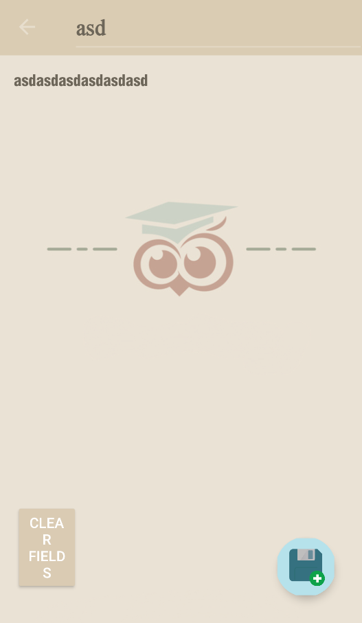
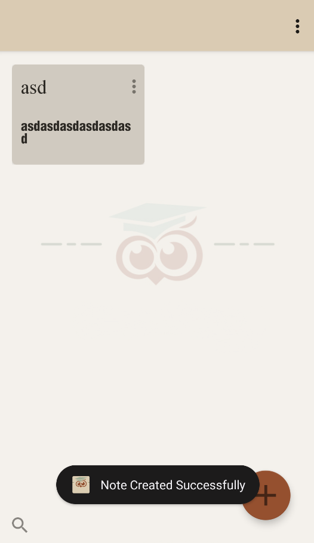
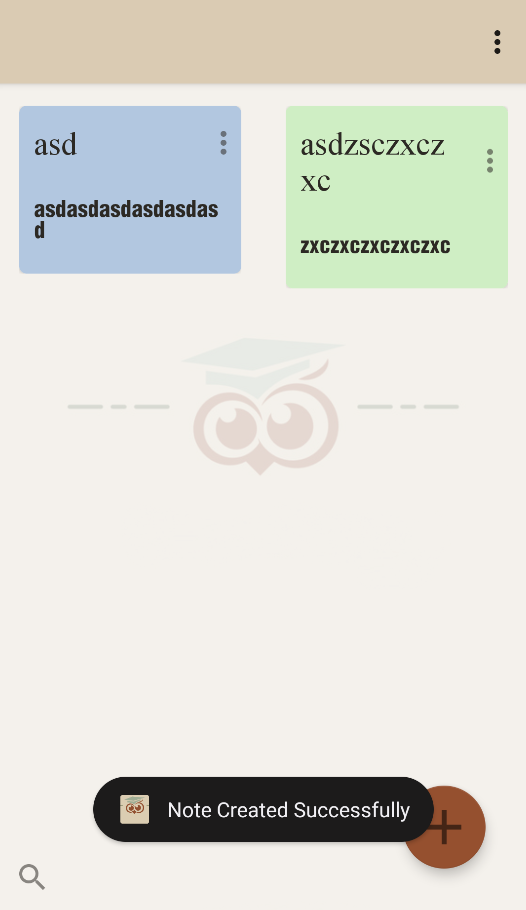
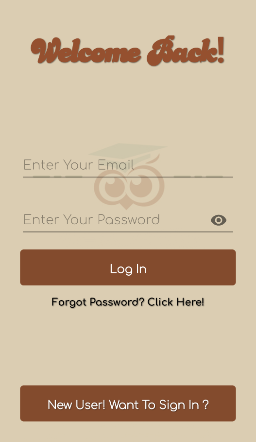

# JournalEase

An offline Android journal with color-coded notes, search, and PDF or Word export.

**Android** · **Learning Project** · 2022

[Portfolio](https://kuraisler.xyz)

## Purpose

JournalEase provides a small, local writing space for notes and journal entries. Users can capture a title and body, find earlier entries, revise them, and export an entry without relying on a cloud database.

## Intended users

Students and casual writers who want simple on-device note-taking and document export.

## Main capabilities

- Create, read, edit, delete, and search notes.
- Browse color-coded note cards in a staggered grid.
- Keep notes locally between app sessions.
- Export an entry as a PDF or DOCX document.

## How it was built

### Native Android screens

Java activities implement splash, demo login, library, detail, and editing screens. RecyclerView displays the note collection.

### On-device persistence

A LocalNoteStore serializes notes as JSON in SharedPreferences. A separate DemoSession stores the local sign-in flag.

### Document export

The export actions use Android PdfDocument and Apache POI to write PDF and DOCX output. The project adapts an earlier tutorial app to local storage.

## Technology stack

| Responsibility | Technologies |
| --- | --- |
| Android application | Java, Android SDK, AppCompat, Material Components, RecyclerView |
| Local storage | SharedPreferences, JSON |
| Document export | Android PdfDocument, Apache POI |

## Project scope and current state

A learning project adapted from a notes-app tutorial. Sign-in is a local demo session, not real authentication or encryption; there is no cloud sync. Export behavior depends on Android storage permissions.

The Android code adapts an earlier notes-app tutorial structure. Existing package and class names reflect that origin; the current persistence and session behavior are local.

## Source guide

- [`app/src/main/java/com/example/notesapptutorial/`](app/src/main/java/com/example/notesapptutorial/)
- [`app/src/main/java/com/example/notesapptutorial/LocalNoteStore.java`](app/src/main/java/com/example/notesapptutorial/LocalNoteStore.java)
- [`app/src/main/java/com/example/notesapptutorial/DemoSession.java`](app/src/main/java/com/example/notesapptutorial/DemoSession.java)

## Development setup

Import the Gradle project into Android Studio, synchronize dependencies, and run on a compatible emulator or device. app/build.gradle targets SDK 33 with minimum SDK 26. The current local demo session and note store do not require Firebase. Test document export permissions on the intended Android version.

## Screenshots

<table>
<tr>
<td align="center"> Brand identity</td>
<td align="center"> Empty state</td>
</tr>
</table>

View all 6 screenshots

### 1. Brand identity

### 2. Empty state

### 3. Note editor

### 4. Confirmation feedback

### 5. Growing collection

### 6. Account authentication

---

Project by [Mark Crysler Baddo](https://github.com/Kuraisura) · [Portfolio](https://kuraisler.xyz)
